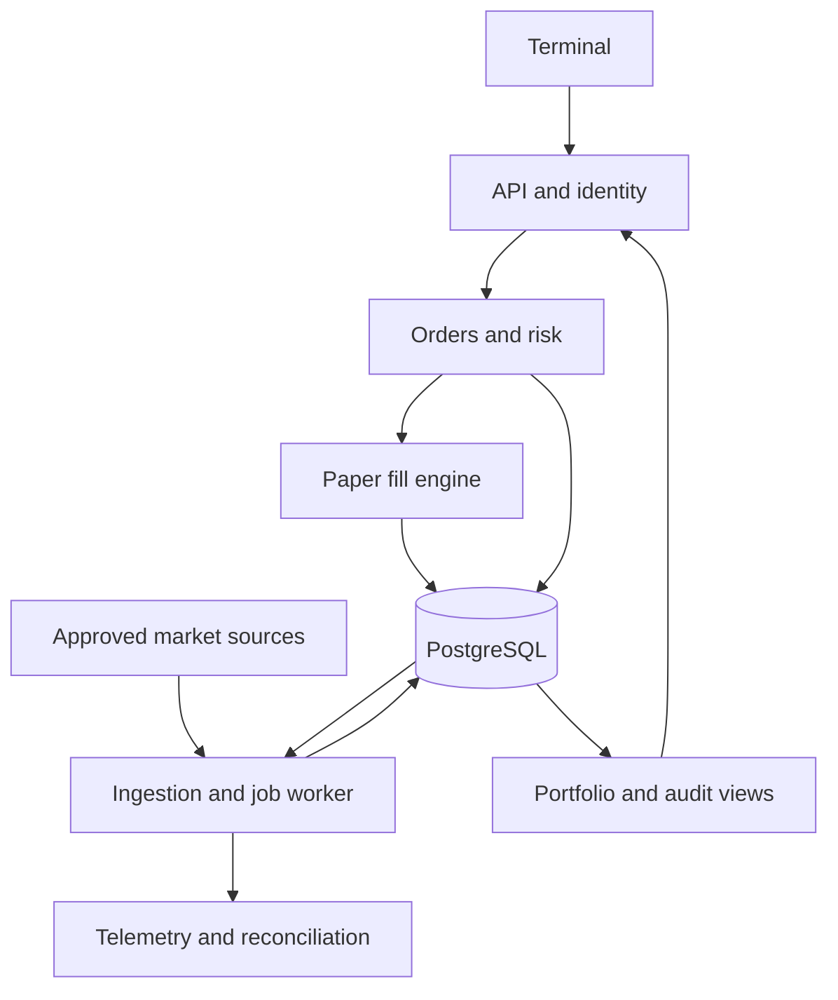

# Cimphawng architecture

**Decision proposal · November 8, 2026 · Scope: spot paper trading**

Cimphawng should become an auditable paper-trading terminal for the Zomi community. The next release should make each fill explainable, keep trading safe during a feed outage, and prove that an operator can recover the system. Preserve the near-black navy terminal, Zomi and English, the browser demo, and the separate CIMP Testnet Lab.

## What runs today

| Surface | Current implementation | Boundary |
| --- | --- | --- |
| Private hosted terminal | Sites / Vinext Worker with D1. Wallet sign-in, paper swaps and resets, operation receipts, account export and deletion, health and readiness. | Owner-private. Hosted scheduled bots and live trading are disabled. |
| Standalone hosted adapter | `hosted/worker.mjs`, D1 migrations and shared Worker API in GitHub. | A separate deployment option; equivalent build and deployment provenance must be verified. |
| Python server | `server/app`, FastAPI, SQLAlchemy, Alembic, PostgreSQL deployment configuration and a paper-bot runner. | A separate implementation, not the private Site's backend. Its feature set and paper account state differ. |
| Browser labs | Terminal simulation, research demos and paper Perps Desk. | Browser-local state and model assumptions. These do not create hosted fills. |
| Token Lab | Base Sepolia test ERC-20 and wallet-controlled signing. | Separate assets and identity context. No redemption, production token issuance or trading authority. |

Baseline reviewed: GitHub `8052896e8f3b181435cfbd5ededdeb99e0046fd8` and private Site source `9fddc4258c2d630e41b74fe0d73ec625670d84a6`. The checked-out inputs differ in terminal HTML, shared CSS, desk HTML, beta CSS and the hosted API. GitHub's fingerprint check failed at that baseline. Fixing the fingerprint in GitHub only validates its own inputs; it does not reconcile the two sources. Treat the prior cbBTC feed degradation as a failure case to reproduce and monitor, not a current incident without a fresh probe.

The current Worker already has useful protections: integer amounts, conditional writes, per-account idempotency keys, stale-price checks, and session revocation. Gaps include a request-driven reference-price cache, no persisted quote-to-fill provenance, no reconciled journal, two backend implementations, and no recorded hosted recovery drill. See [launch readiness](LAUNCH-READINESS.md) for evidence and open gates.

## Target system and ownership

Use a **modular monolith** with a FastAPI application and PostgreSQL for the next durable paper system. Start with an API process and a separately runnable background worker built from the same versioned code. Use the current Worker/D1 for the private beta until a rehearsed cutover. Keep PostgreSQL as the sole writer after cutover. Keep the browser on a same-origin API so routing changes do not become session or CORS workarounds.

| Module | Owns | Rule |
| --- | --- | --- |
| API and identity | Sessions, membership, authorization, request validation, API versioning | Wallet ownership grants access to an account. Operator access is separate and explicitly assigned. |
| Market data | Instrument registry, source adapters, normalized observations, quality and freshness | Only validated observations may drive paper fills. Browser feeds are display-only. |
| Orders and risk | Idempotency, order transitions, eligibility, limits, pause state | Manual and strategy orders use one command path. A strategy emits intents and cannot write balances. |
| Paper fills and ledger | Fill model, atomic settlement, immutable economic events, balance projection | Only this module posts journal entries. A fill cannot exist without its balanced entries. |
| Jobs and reconciliation | Scheduled refresh, outbox consumption, integrity checks and alerts | Workers handle retries and duplicate deliveries explicitly; they cannot bypass risk or write directly to balances. |
| Research | Versioned datasets, strategy versions, backtests, experiment reports | Read-only access to approved inputs. No production order or ledger writes. |

No Redis, separate message broker, Kubernetes, or timeseries extension is required for the first release. Measure database, worker and API load before adding infrastructure. Select and price the production host after checking backups, access controls and support; the existing Hetzner files are an option, not evidence of a production deployment.

## Market data: provenance before execution

1. **Identify instruments unambiguously.** Use chain, token contract, decimals and quote currency, plus reviewed pool identifiers. Treat ETH/WETH and cbBTC as distinct from unrelated ticker matches. Track provider permissions, attribution, retention and approved use.
2. **Refresh independently of user requests.** Schedule per-instrument fetches with deadlines, bounded retries and backoff. Store provider, pool, provider event time when available, ingest time, precision and quality. Handle missing provider timestamps explicitly: fetch time alone does not prove market freshness. Keep the previous valid record after a failed refresh.
3. **Distinguish reference, indicative and executable prices.** A pool reference can mark a portfolio; it does not imply fillable size. For the initial simulator, use a documented, bounded size/fee/slippage model. Record the inputs and model version. Display estimated costs and reject when depth is missing or the order exceeds the model's approved size. Model a USD peg assumption explicitly where used.
4. **Set quality rules per instrument.** Reject stale, malformed, future-dated, mismatched or materially divergent observations. An alternate source must pass the same validation; never substitute synthetic prices or the wrong asset. Allow fresh unaffected instruments to continue while a stale instrument is paused.
5. **Record what a fill used.** Persist quote ID, normalized observations, model and fee versions, expiration, approved amount, worst acceptable output and risk policy version. Revalidate expiration and eligibility at commit. If a reference feed fails, show the last observation with age and suppress affected fills.

The initial scope is the existing Base spot instruments. On-chain indexing, historical data licensing and an independent fallback source each need their own evaluation. If raw on-chain events are introduced, record block hashes and track provisional, confirmed and invalidated observations; prove the gap-fill and reorg path before using them in decisions.

## Order, risk and ledger contracts

Introduce versioned commands under `/api/v2` in staging, while preserving existing private beta routes. Start with immediate spot paper orders only. Do not show partially filled, cancelable or resting orders until the backend actually supports them.

| Contract | Minimum behavior |
| --- | --- |
| Quote | Account and instrument, input quantity, estimate and bound, fees, observation IDs, expires-at and model version. Missing or expired quote cannot fill. |
| Order | Stable server ID and account-scoped client key, canonical payload hash, explicit terminal outcome and correlation ID. Identical retry returns the stored outcome; same key with a different payload returns a conflict. |
| Risk decision | Allowlisted instrument, sufficient available funds, size and exposure limits, fresh data, active account epoch and pause state. Record reason, policy version and quote reference. |
| Fill and journal | Fixed-point amounts with explicit asset precision and rounding, separate principal and fee entries, and an atomic transaction linking order, decision, fill and journal. No negative member balances. |
| Portfolio | Read model derived from journal entries, carrying a last-applied checkpoint and valuation freshness. Reconcile projections and expose an explicit degraded state on drift. |

Inside the write transaction: resolve the idempotency key, lock the relevant account/position rows in a consistent order, then recheck funds, quote expiry and risk. Persist the accepted outcome, journal and outbox together. Roll back the entire write on error; retry transient transaction conflicts only under the same key and bounded retry policy. Keep upstream HTTP calls outside that transaction. Return the committed outcome on timeout/retry. Retain receipts for the documented replay window; do not allow expired requests to silently become new orders.

For a paper swap, each asset balances independently. If a member spends 100 paper USDC including a 0.30 USDC fee, debit 100 from the member, credit 99.70 to simulated liquidity and 0.30 to a fee account. In the acquired asset, debit simulated liquidity and credit the member by the same amount. Portfolio reset closes one account epoch and opens another with a grant entry; it cannot alter prior fills or allow an old request to post into the new epoch. Correct errors using reversal entries and a recorded reason.

Suggested schema: `instruments`, `market_observations`, `paper_quotes`, `paper_orders`, `risk_decisions`, `paper_fills`, `journal_transactions`, `journal_entries`, `balance_projections`, `operation_receipts`, `outbox`, `processed_events` and `reconciliation_runs`. Give events unique IDs, schema versions, request correlation, actor references and UTC timestamps. Do not duplicate wallet addresses or other personal data across payloads. Define retention, deletion and backup handling before opening access; keep the identity mapping separate from economic entries. Pseudonymized records still need a retention and privacy review.

A worker delivers committed outbox events with retry/backoff and idempotent consumers. Track lease ownership and dead-letter exceptions. Treat downstream delivery as repeatable, not exactly once. Reconcile replayed journal balances, projected balances and fill/receipt counts. Freeze affected paper writes on unexplained discrepancies and require reviewed resolution.

## Security, operations and research gates

- **Identity and operator actions:** retain domain-bound, single-use wallet challenges and secure sessions. Define member and operator scopes. Require stronger operator authentication, least privilege and reviewed changes to risk limits or resume controls. Maintain paper, research and testnet isolation; no server-side signing key or mainnet submission route in this design.
- **Pause and resume:** an operator pause blocks new fills through the same transactional risk path. It leaves reads and audit access available. Resume after fresh observations and reconciliation pass; record actor, reason and time. Test pauses under concurrent orders.
- **Release controls:** one canonical GitHub commit per release, repeatable asset assembly, fingerprint and artifact digest verification, CI evidence, staged migration and smoke checks. Record the GitHub commit and resulting Site commit/version when both are used. Include intended divergence explicitly; never infer source parity from a successful deploy.
- **Observability:** separately measure API availability, quote age and feed rejects by instrument, fill commits and duplicates, reconciliation drift, worker lag, and restore performance. Use request/order correlation IDs in restricted logs; omit signatures, cookies and raw credentials. Check that alerts reach an assigned operator.
- **Research:** freeze strategy and dataset versions, include fee/slippage assumptions, use time-ordered evaluation without future data, and record out-of-sample and forward-paper results. Paper strategies are opt-in, versioned, capped and pauseable. Scheduling must deduplicate each strategy/instrument/candle/configuration decision.
- **Live work is separately scoped.** Mainnet CIMP, custody, perpetuals, user-signed swaps, automated live execution and capital deployment are outside this release. Any later proposal needs its own permissions, venue and legal review, security assessment, and limits; a paper pass does not authorize live trading.

### Initial acceptance targets

Targets below are proposed for a small invited paper beta. Record measurements in staging and revise targets with the owner before promotion. They are not current production guarantees.

| Measure | Proposed pass condition |
| --- | --- |
| Ledger integrity | Zero unbalanced journal transactions, duplicate fills or unexplained projection discrepancies in retry, concurrency, outage and reset scenarios. |
| Traceability | 100% of test fills trace to a quote, observations, policy decision and balanced journal. |
| API performance | At 20 active simulated members, p95 under 300 ms for cached portfolio reads and under 750 ms for valid paper submissions using a precomputed quote, excluding wallet interaction. Run for at least 30 minutes; publish latency, errors and DB headroom. |
| Feed safety | Use the current 120-second cutoff as the initial ceiling, configurable per instrument. Tests must demonstrate old timestamps survive outages, rejected fills do not mutate balances, and unaffected instruments can still fill. |
| Alerting | A sustained feed outage or halted worker triggers a test alert to the assigned operator within five minutes; reconciliation mismatch pauses writes and alerts on detection. |
| Recovery | Rehearse recovery in an isolated environment to an approved target of at most 15 minutes of data loss and 60 minutes to restored service. Measure the actual restore point, duration and reconciliation result. |
| Private beta | Desktop and mobile wallet test matrix, access/privacy checks, rollback drill, and seven days of monitored invited paper operation with no unresolved integrity or access incidents. |

## Build order and cutover

| Slice | Deliver | Exit evidence |
| --- | --- | --- |
| 0 · Release baseline | Inventory GitHub and Site differences; choose which changes to retain (including near-black UI); reconcile them into one reviewed source. Capture release manifest and feature flags. | Clean fingerprint and build from GitHub; compare release manifest and deployed artifact; wallet smoke on the intended domain. |
| 1 · Market data | Add normalized instrument/observation contracts, provider diagnostics and scheduled ingestion in staging. | Fixture and failure injection for cbBTC/ETH timeouts, stale/future data, malformed response and recovery. Measure refresh and alert behavior. |
| 2 · Paper core | Implement the PostgreSQL journal and order command path behind staging-only access. Keep existing UI contract via adapter. | Concurrent spends, repeat POSTs, after-commit timeout, quote expiry, pause/reset races, reversal and journal replay pass on PostgreSQL. |
| 3 · Migration rehearsal | Dry-run export and restore against sanitized data. Map existing wallet accounts, balances, archived trades and idempotency receipts. | Prove amounts, counts, account isolation and outcome replays; report mapping exceptions and measured restore time. |
| 4 · Controlled cutover | Pause old writes, take an approved snapshot, import and reconcile, route to one writer, require new sign-in, and run a signed-off smoke test. | Checksums, per-asset balances and counts agree; no dual writes; owner approves reopening. Invited users test on desktop and mobile. |
| 5 · Paper strategies | Integrate the existing bot ideas through the common order path. | Replay reproduces decisions; scheduler restarts do not duplicate fills; limits and pauses behave the same as manual paper trading. |

Historical trades may lack market provenance. Keep them as explicitly labeled legacy records; migrate opening balances through documented opening entries rather than inventing historical quotes. Preserve or explicitly quarantine unresolved legacy idempotency outcomes so pre-cutover retries cannot spend twice. Revoke prior sessions instead of copying secrets or hashes between systems.

Before enabling writes on the new store, rollback can point back to the frozen old writer. After new writes occur, freeze and reconcile first. Roll back app code against the new store if compatible; moving the writer back requires a separately verified reverse transfer. Never reopen the old writer with stale balances. Retain a secure, time-limited source snapshot under the approved retention policy.

## Related project references

- [Current private beta checks and recovery runbook](LAUNCH-READINESS.md)
- [Worker adapter and safeguards](../hosted/README.md)
- [Python server and paper bots](../server/README.md)
- [Deployment instructions for the optional Python stack](DEPLOY.md)
- [CIMP Testnet Lab](CIMP-TESTNET.md)
- [Previous architecture and lab implementation notes](https://github.com/mangpijasuan/cimphawng/blob/8052896e8f3b181435cfbd5ededdeb99e0046fd8/docs/ARCHITECTURE.md)
