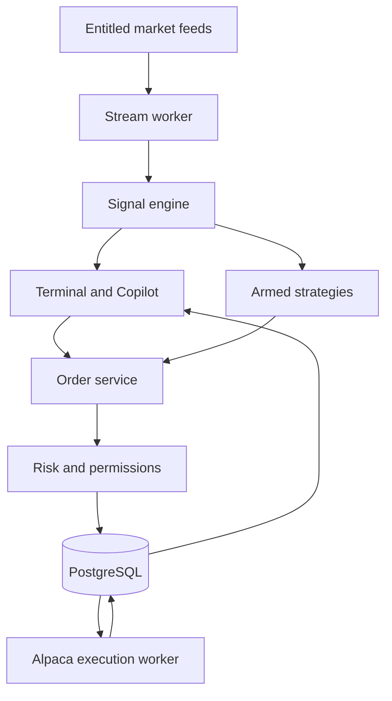

# Cimphawng Trade — product and execution architecture

**Proposed architecture · November 13, 2026**  
**Target domain:** `cimphawng.trade` (ownership, DNS, TLS and OAuth registration still to verify).

Cimphawng Trade is a multi-asset terminal for real-time signals, order review and opt-in execution. Launch with Alpaca paper accounts, then promote each live capability independently. Keep the near-black navy theme, red-and-navy mark, and English/Zomi interface.

## Current baseline

Reviewed GitHub `577d0f57a8420827bee3e34120c489ee7ddd3ba0`. The private Site uses a Worker and D1 for an internal paper portfolio. The repository also contains a separate FastAPI/PostgreSQL paper service, browser simulations and a Base Sepolia Token Lab. The token contract rejects Base mainnet. No Alpaca integration, mainnet token, or verified live execution is assumed. The [paper architecture](ARCHITECTURE.md) remains the foundation for provenance, transaction integrity and recovery.

## Product design

[Guided Trading](GUIDED-TRADING.md) is the default beginner experience: explain the top qualified setup, preview the risk, and review a paper order. Terminal remains available for advanced users. Both use the same eligibility rules and execution gateway.

| Workspace | Main interaction |
| --- | --- |
| Command Center | Feed health and age, market session, connected account, positions, risk usage and open orders. Pin Paper/Live and Manual/Copilot/Automated in the header. |
| Signals | Filter Stocks, Options and Crypto. Show setup, triggering observation, strategy version, expiration, current spread and invalidation. Keep historical or stale signals visible as such. |
| Trade Desk | Chart and quote beside the order ticket; show account, asset, size, limit, estimated fees, buying power, and risk decision. On mobile, open a dedicated review sheet. |
| Automation | Arm an approved strategy version for one account and environment; select allowed instruments, position and loss caps, expiry and session. Show armed/paused state and last action. |
| Orders & Portfolio | Broker-backed order timeline, partial fills, cancel-pending state, cash, exposure and reconciliation status. |
| Connections & Token Lab | Link or revoke Alpaca access; show account permissions. Keep testnet balances and future wallet-signed CIMP swaps in their own workspace. |

**Manual:** the user builds and confirms a ticket. **Copilot:** suggests and explains a draft with evidence, but only the user confirms. Approval binds the exact account, environment, side, quantity, order type, price bounds and expiry; material changes invalidate it. **Automated:** a versioned deterministic strategy can submit only within a user's explicit, revocable mandate. Default is disarmed; a strategy update requires a new approval. Copilot cannot arm mandates, override risk checks or reach broker credentials.

## Runtime and trust boundaries

Use the existing FastAPI/PostgreSQL direction, with separately runnable stream and execution workers from one versioned codebase. Use a transactional outbox to persist accepted intents before sending, and an inbox to deduplicate broker updates. Start with PostgreSQL queues and a small symbol universe. Introduce additional streaming infrastructure only when measurements justify it. The current private Site remains a preview; avoid operating two writers for the same account.

Identity binds each app user to explicit broker connections. Start with owner-controlled Alpaca paper credentials in a secret store for integration tests, then use **Alpaca Connect OAuth** for existing customer accounts. Register the exact callback on the intended HTTPS domain; validate single-use, session-bound state, request minimum scopes, exchange codes on the server, and encrypt tokens. Bind account and environment server-side. Keep paper and live credentials, queues and UI sessions separated. Live access for other users and commercial use need the applicable Alpaca approvals. Evaluate Broker API separately only if embedded account opening is needed.

## Market data and signal quality

Subscribe server-side to Alpaca stock, options and crypto streams according to entitlements. Normalize venue, instrument, event and ingest timestamps, quote/trade type and feed quality. Reconnect with bounded backoff, deduplicate, detect gaps where possible, and restore from snapshots or backfill before resuming signals. Persist decision inputs and signal versions; fan out updates to the browser via SSE or WebSocket. Keep broker updates separate from quote traffic. Scope subscriptions to the instruments being watched or traded.

US stocks: distinguish exchange-limited IEX coverage, delayed data and consolidated SIP coverage. Options: distinguish indicative data from OPRA; require entitled, fresh executable-quality quotes for live option execution. Use allowlisted underlying symbols, approved account levels, whole contracts, and initial single-leg long calls/puts with limit orders. Verify contract multiplier, expiry, liquidity, spread, buying power and exercise/expiry handling. Crypto: allowlist currently tradable Alpaca spot pairs per account and check quantity increments, order type and regional eligibility. Do not assume matching symbols represent the same venue or instrument.

Emit signals from tested deterministic rules with point-in-time inputs. Include entry trigger, invalidation, horizon, expiration, data provenance and model/version. AI can explain the evidence and fill draft fields; typed risk and pricing code validates every field. No live automation from delayed, stale or unverified data. Require holdout and forward-paper evidence with costs, spread/slippage, drawdown and rejected/missed fills before promoting any strategy. No simulated outcome is advertised as live performance.

## Orders, risk and reconciliation

- Use one order gateway across all three modes. Check consent, account eligibility, session, freshness, position and open-order exposure, buying power, per-order notional, loss caps and kill switches. Reserve risk capacity atomically to prevent concurrent overspending. Repeat time-sensitive checks at dispatch.
- Record immutable order intents and decisions. Use an app idempotency key and stable Alpaca `client_order_id`. A submission timeout is **unknown**, not rejected: query by that ID, reconcile open orders and positions, and do not blindly resubmit. Duplicate or late events must not add fills twice or regress state.
- Track draft, approved, blocked, submission unknown, accepted, partial fill, filled, cancel pending, canceled, rejected and expired. Broker observations are authoritative for live orders and positions. Record fills and match them to broker activity; keep internal paper ledgers separate.
- Provide per-account and global pause controls. Pausing blocks new submissions and alerts on in-flight work. A request to cancel working orders is separate, and cancel is not final until broker confirmation. No automatic liquidation on pause. Halt affected account or instrument on unresolved reconciliation, feed or permission issues.
- Keep audit trails for signals, approvals, mandate revisions, order events, risk decisions and operator changes. Keep secrets out of logs. Recovery must reconcile with Alpaca before rearming automation; restoring the app database alone cannot undo an executed trade.

Start schema: `broker_connections`, `instrument_registry`, `market_observations`, `strategy_versions`, `signal_events`, `order_intents`, `user_approvals`, `automation_mandates`, `risk_reservations`, `broker_orders`, `broker_events`, `fills`, `outbox`, `reconciliation_runs`. Store money/quantity in exact decimals and use UTC timestamps and versioned schemas. Scope unique keys and authorization by account and environment.

## Real CIMP: separate launch and trading venue

Use the existing **Base Sepolia** lab for rehearsals. If approved, create a separate Base mainnet ERC-20 with a reviewed supply, allocations, vesting and treasury permissions. A fixed supply with no hidden mint authority is the starting design; mainnet amounts are undecided. Use reproducible builds, contract verification, independent security review and documented multisig control over treasury funds. The current 1 million test tokens and paper balances have no conversion into mainnet CIMP.

A deployed token does not create a market. A potential **CIMP/USDC DEX pool** requires verified asset contracts, an approved initial price and funded liquidity, custody and withdrawal rules, market monitoring and disclosures. Start with read-only pricing and explicit external links; add wallet-signed swaps only after validating chain and pool addresses, approvals, slippage and transaction previews. Show thin liquidity, price impact and unconfirmed transactions clearly. Do not list CIMP as Alpaca-tradable unless Alpaca explicitly supports it. The first CIMP design does not allow broker funding, margin collateral, revenue sharing, profit promises, or autonomous treasury trading.

Treat personalized recommendations, customer auto-execution, token distribution and liquidity arrangements as separate legal and provider review decisions. No domain cutover, account connection, live order, contract deployment, token distribution or liquidity funding is authorized by this design document.

## Delivery and promotion gates

| Stage | Deliverable | Exit evidence |
| --- | --- | --- |
| 1 · Paper connection and orders | Owner Alpaca paper connector, read-only account and positions, manual limit ticket for a small US stock/ETF universe, order timeline. | Paper-only URL/credential enforcement; tested normal, timeout, duplicate, partial fill, cancel and reconciliation cases. |
| 2 · Real-time signals and Copilot | Entitled stock stream, versioned signals and editable drafts with expiring approval. | Measure feed-to-UI p95 on approved universe (initial target under 2 seconds for fresh in-order events); replay disconnects, stale data and changed approvals. |
| 3 · Options and crypto paper | Eligible option contracts and supported spot crypto; per-asset rules and risk controls. | Evidence for account levels, session rules, expiry, precision, liquidity, and missing/delayed quotes. |
| 4 · Automated paper | Versioned mandates, risk limits, kill switch and restart recovery. | Zero duplicate submissions in fault-injection tests, verifiable stop of new orders after pause, and a forward-paper evaluation with predeclared thresholds. |
| 5 · Limited live rollout | First approved accounts on the chosen domain; manual/Copilot before automation. | Alpaca and legal review, market-data distribution rights, operational drills, signed-off account caps, and explicit live opt-in. Promote each asset/mode independently. |
| Parallel · CIMP | Utility and distribution decision, Sepolia rehearsal, contract and venue review. | Independent approval for deployment and a second decision for funding liquidity or offering swaps. |

First implementation PR: **Alpaca paper connection, account read and one manual limit-order path with reconciliation**. Use a fake broker in CI and a dedicated paper account for the integration smoke test. No live endpoint is needed to deliver it.

## Primary references

- [Alpaca Connect requirements](https://docs.alpaca.markets/us/docs/about-connect-api) and [OAuth flow](https://docs.alpaca.markets/us/docs/using-oauth2-and-trading-api)
- [Alpaca market data and entitlements](https://docs.alpaca.markets/us/docs/about-market-data-api), [streaming](https://docs.alpaca.markets/us/docs/streaming-market-data), and [options stream](https://docs.alpaca.markets/us/docs/real-time-option-data)
- [Alpaca options rules](https://docs.alpaca.markets/us/docs/options-trading-overview), [supported crypto pairs](https://alpaca.markets/support/what-cryptocurrencies-does-alpaca-currently-support), and [client order lookup](https://docs.alpaca.markets/us/v1.4.2/reference/getorderbyclientorderid)
- [SEC electronic investment advice risk alert](https://www.sec.gov/files/exams-eia-risk-alert.pdf) and [SEC/CFTC crypto asset interpretation](https://www.sec.gov/rules-regulations/2026/03/s7-2026-09)
